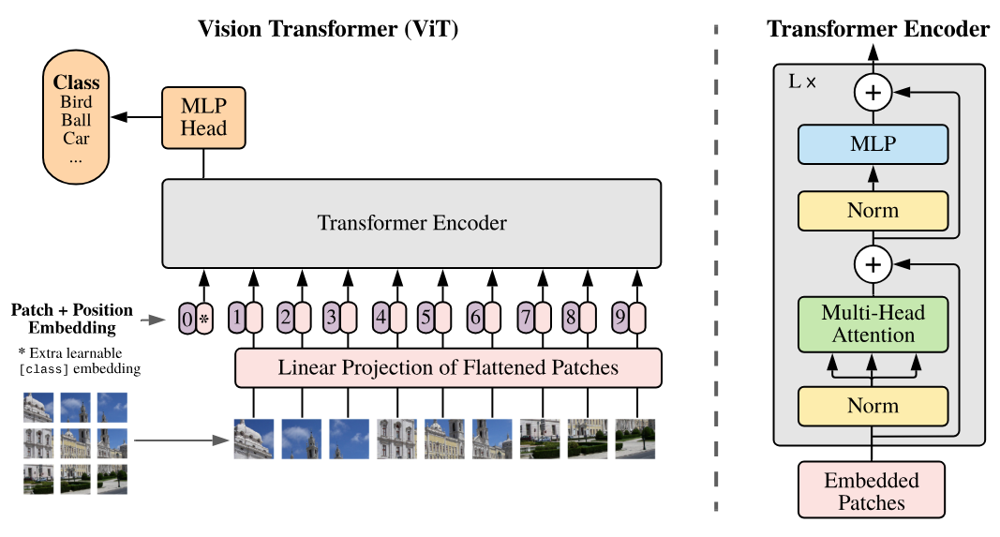
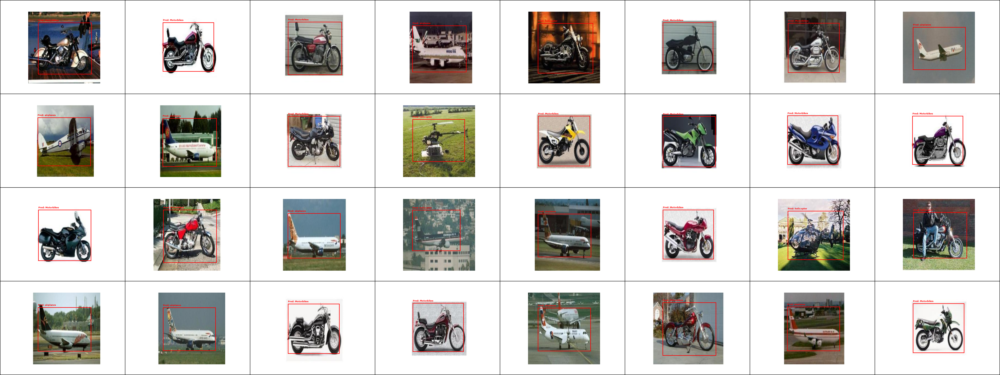

# Object Detection with Vision Transformer (ViT) ✈️🚁🏍️

## Overview

This project implements a **Vision Transformer (ViT) from scratch using PyTorch** for single-object detection and classification.

The model is designed to detect and localize three object categories:
- ✈️ Airplanes
- 🚁 Helicopters
- 🏍️ Motorcyclists

The implementation is based on the original Vision Transformer paper:

📄 [An Image is Worth 16x16 Words: Transformers for Image Recognition at Scale](https://arxiv.org/abs/2010.11929)

Unlike traditional CNN-based approaches, Vision Transformers process images as sequences of patches and leverage self-attention mechanisms to learn visual representations.

The model is adapted for object detection by predicting both the **object class** and its **bounding box coordinates**.

## Architecture

The model follows the original Vision Transformer architecture, adapted for single-object detection.

<p align="center">
  
</p>

### Model Configuration

The implemented model is based on **ViT-Tiny**, with the following configuration:

| Parameter | Value |
|-----------|-------|
| Model | ViT-Tiny |
| Input Resolution | 224 × 224 |
| Patch Size | 16 × 16 |
| Embedding Dimension | 192 |
| Attention Heads | 3 |
| Transformer Layers | 12 |
| MLP Dimension | 768 |
| LayerNorm Epsilon | 1e-5 |
| Dropout | 0.1 |
| Attention Dropout | 0.1 |

## Project Structure

```text
.
├── assets/                  # Architecture diagrams and detection results
├── src/                     # Source code
│   ├── ...                  # Model implementation
│   ├── ...                  # Training utilities
│   ├── ...                  # Data preprocessing
│   └── download_dataset.py  # Dataset download script
├── train.ipynb              # Model training notebook
├── evaluate.ipynb           # Model evaluation notebook
├── requirement.txt          # Python dependencies
└── README.md
```

## Installation

### 1. Clone the repository

```bash
git clone https://github.com/DMAHW28/VIT-Object-Detection.git
cd VIT-Object-Detection
```

### 2. Install dependencies

Make sure you have Python installed.

```bash
pip install -r requirement.txt
```

## Dataset

The dataset contains images from three object categories:

- Airplanes
- Helicopters
- Motorcyclists

Download the dataset using:

```bash
python src/download_dataset.py
```

## Training

The model is trained using PyTorch.

To train the Vision Transformer, open and execute:

```text
train.ipynb
```

The training pipeline includes:
- Image preprocessing and resizing
- Data augmentation using Albumentations
- Patch embedding and positional encoding
- Transformer-based feature extraction
- Object classification and bounding box regression

## Evaluation

Model performance is evaluated on the test dataset using classification and localization metrics.

### Test Results

| Metric | Score |
|--------|-------|
| **Classification Accuracy** | **93.00%** |
| **Intersection over Union (IoU)** | **0.8653** |
| **Distance IoU (DIoU)** | **0.8642** |
| **F1-Score** | **0.86** |

The model achieves **93% classification accuracy** and an **IoU of 0.8653**, demonstrating its ability to classify and localize objects within images.

For detailed evaluation, see:

```text
evaluate.ipynb
```

## Detection Results

The following examples illustrate the model's predictions on test images.

<p align="center">
  
</p>

## Technologies

- **PyTorch** — Deep learning framework
- **NumPy** — Numerical computing
- **Pillow (PIL)** — Image processing
- **Albumentations** — Data augmentation

## References

Dosovitskiy, A., et al. (2020).

**An Image is Worth 16x16 Words: Transformers for Image Recognition at Scale.**

[Paper](https://arxiv.org/abs/2010.11929)